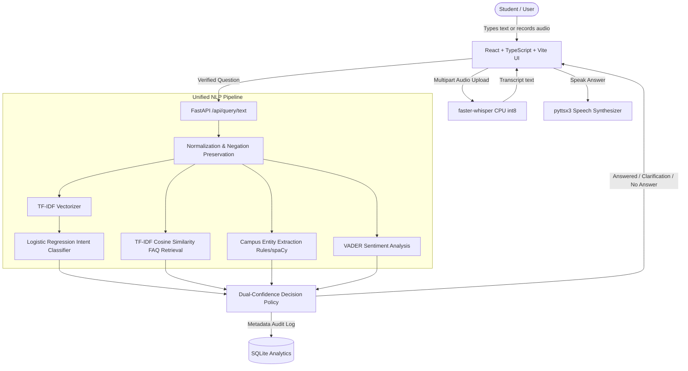

# VoiceBridge: Speech-Enabled Campus Helpdesk

> **Speech-Enabled Campus Helpdesk with Confidence-Aware Answer Retrieval and Explainable Speech Feature Analysis**  
> *Subject:* Natural Language Processing & Speech Processing  
> *Frontend:* React + TypeScript + Vite  
> *Backend:* Python 3.11 + FastAPI (isolated virtual environment `.venv`)

---

## 1. Project Abstract & Overview

**VoiceBridge** is an intermediate-level undergraduate mini-project demonstrating applied Natural Language Processing (NLP) and Speech Signal Processing. Students can submit campus inquiries via typed text, recorded microphone audio, or audio file uploads. The system performs automatic speech recognition (ASR), presents an editable transcript to correct transcription errors, predicts query intent using statistical machine learning, extracts key campus entities, estimates sentiment, and retrieves verified institutional answers from a locally indexed FAQ knowledge base.

Unlike standard conversational agents that invent plausible responses when uncertain, VoiceBridge introduces a **dual-confidence decision policy**. It independently evaluates intent classification confidence and FAQ cosine similarity. If relevance or confidence falls below configured thresholds, VoiceBridge safely withholds answers or requests clarification. Furthermore, a dedicated **Speech Lab** visualizes acoustic signal features (waveform, short-time energy, zero-crossing rate, STFT spectrogram, and MFCCs).

---

## 2. Key Features

- **Dual-Input Modalities:** Typed questions and speech input (browser `MediaRecorder` or audio file upload).
- **Transcript Verification:** Users inspect and correct automated ASR transcripts before submitting them to the NLP engine.
- **Dual-Confidence Decision Engine:** High classifier confidence cannot override an irrelevant FAQ match, and high FAQ similarity cannot override ambiguous intents.
- **Explainability Panel:** Inspect intent probability, FAQ relevance percentage, detected campus entities, and sentiment polarity.
- **Speech Lab:** Real-time computation and Canvas rendering of Waveform, Short-Time Energy (STE), Zero-Crossing Rate (ZCR), STFT Spectrogram, and MFCC heatmaps.
- **Privacy-Preserving SQLite Analytics:** Stores only non-sensitive aggregate event metadata; raw student query strings and audio recordings are never persisted.
- **Honest Empirical Evaluation:** Holds out 25% of synthetic data to compute real classification accuracy, confusion matrices, and top-1 FAQ retrieval rates without fabricated metrics.

---

## 3. Syllabus Concept Mapping

| Syllabus Topic | VoiceBridge Implementation |
|---|---|
| **Text Preprocessing** | Regex normalization, whitespace cleaning, contraction expansion, and negation preservation. |
| **Vector Space Model & TF-IDF** | Sublinear TF-IDF vectorization with unigrams and bigrams for intent modeling and FAQ cosine similarity ranking. |
| **Statistical Machine Learning** | Multinomial Logistic Regression with balanced class weights trained strictly on stratified splits. |
| **Named Entity Recognition (NER)** | Campus entity extraction (departments, semesters, campus services, offices, dates) with spaCy fallback. |
| **Sentiment Classification** | VADER sentiment polarity scoring with compound thresholding into Positive, Neutral, and Negative. |
| **Short-Time Signal Analysis** | Frame-based Short-Time Energy (STE) and Zero-Crossing Rate (ZCR) computation using Hann windows. |
| **Time-Frequency Representation** | Short-Time Fourier Transform (STFT) magnitude spectrogram converted to logarithmic decibel scale. |
| **Cepstral Speech Features** | Mel-Frequency Cepstral Coefficients (MFCCs) computed via triangular Mel filterbanks and discrete cosine transform. |
| **Automatic Speech Recognition** | Local, offline speech-to-text inference powered by faster-whisper CPU int8 quantization. |
| **Speech Production & Synthesis** | Local offline text-to-speech synthesis via `pyttsx3`. |

---

## 4. System Architecture



---

## 5. Repository Structure

```text
Mini_Project/
├── backend/
│   ├── app/
│   │   ├── api/             # FastAPI REST route controllers
│   │   ├── data/            # Datasets (intent_examples.csv, faq.csv, retrieval_test_cases.csv)
│   │   ├── evaluation/      # Held-out evaluation metrics artifact (intent_metrics.json)
│   │   ├── models/          # Persisted sklearn pipeline (intent_model.joblib)
│   │   ├── schemas/         # Pydantic request and response models
│   │   ├── services/        # Preprocessing, classifier, retriever, NER, audio, ASR, TTS
│   │   ├── config.py        # Centralized settings and thresholds
│   │   └── main.py          # FastAPI application entrypoint with CORS
│   ├── scripts/
│   │   ├── validate_data.py       # Dataset schema and integrity validator
│   │   ├── train_intent_model.py  # Stratified model trainer (no data leakage)
│   │   └── evaluate_models.py     # Generates held-out metrics & confusion matrix
│   ├── tests/               # 34 automated pytest unit & integration tests
│   ├── requirements.txt     # Backend Python dependencies
│   └── .env.example
├── frontend/
│   ├── src/
│   │   ├── api/             # Typed API client and TypeScript interfaces
│   │   ├── components/      # Reusable UI cards, forms, canvas heatmaps, audio charts
│   │   ├── pages/           # Home, SpeechLab, Analytics, Evaluation, About
│   │   ├── styles/          # Responsive CSS styling
│   │   ├── App.tsx          # Application shell and tab router
│   │   └── main.tsx
│   ├── package.json
│   ├── vite.config.ts
│   └── tsconfig.json
├── docs/
│   ├── ARCHITECTURE.md      # Detailed system architecture and sequence flows
│   └── API_REFERENCE.md     # Complete REST endpoints specification
├── PROJECT_REPORT.md        # Comprehensive student viva project report
├── .gitignore
└── README.md
```

---

## 6. Installation & Execution Guide

### Prerequisites
- **Python:** 3.10 or 3.11 (Tested with Python 3.11.0)
- **Node.js:** v18+ (Tested with Node.js v24.15.0 & npm 11.12.1)

---

### Step 1: Backend Setup (Isolated Virtual Environment)

Open a terminal in the project directory:

#### On Windows (PowerShell):
```powershell
cd backend
python -m venv .venv
.\.venv\Scripts\Activate.ps1
python -m pip install --upgrade pip
pip install -r requirements.txt
```

#### On Linux / macOS:
```bash
cd backend
python3 -m venv .venv
source .venv/bin/activate
python -m pip install --upgrade pip
pip install -r requirements.txt
```

---

### Step 2: Validate Data, Train Models, and Run Tests

While inside `backend` with the virtual environment activated:

```powershell
# 1. Verify CSV dataset schemas and references
python scripts/validate_data.py

# 2. Train intent classifier on stratified train split
python scripts/train_intent_model.py

# 3. Generate genuine held-out evaluation metrics
python scripts/evaluate_models.py

# 4. Execute all 34 automated unit and integration tests
pytest
```

---

### Step 3: Run the FastAPI Backend Server

```powershell
# Inside backend directory with .venv active
uvicorn app.main:app --reload --host 127.0.0.1 --port 8000
```
The backend API is accessible at:
- **API Root:** `http://127.0.0.1:8000`
- **Interactive Swagger Docs:** `http://127.0.0.1:8000/docs`
- **Health Check:** `http://127.0.0.1:8000/api/health`

---

### Step 4: Run the React Frontend Application

Open a **second terminal** in the project root:

```powershell
cd frontend
npm install
npm run dev
```

Open your browser to the local Vite URL printed by the command (typically **`http://localhost:5173`**).

---

## 7. How to Add Campus FAQs and Retrain

1. Open `backend/app/data/faq.csv` in any spreadsheet editor or text editor.
2. Add your institutional FAQ entries with appropriate `faq_id`, `intent`, `question`, `answer`, `keywords`, and `office_or_category`.
3. Add corresponding synthetic question variations to `backend/app/data/intent_examples.csv`.
4. Run:
   ```powershell
   python scripts/validate_data.py
   python scripts/train_intent_model.py
   python scripts/evaluate_models.py
   ```
5. Reload the browser to interact with the newly updated model and knowledge base!

---

## 8. Limitations & Viva Review Points

- **Synthetic Training Data:** The model was trained on synthetic campus queries. In production, a dataset of genuine student questions should be collected and annotated.
- **Statistical Representation:** TF-IDF with Logistic Regression is computationally efficient and explainable, but it lacks deep contextual word embeddings.
- **Cosine Similarity Interpretation:** Cosine similarity is a geometric vector relevance score between query and FAQ vectors, not a calibrated mathematical probability of factual correctness.
- **Signal Analysis vs ASR:** Speech Lab features (MFCC, STE, ZCR, Spectrogram) visually describe audio physical characteristics; they do not perform phonetic language transcription on their own.
