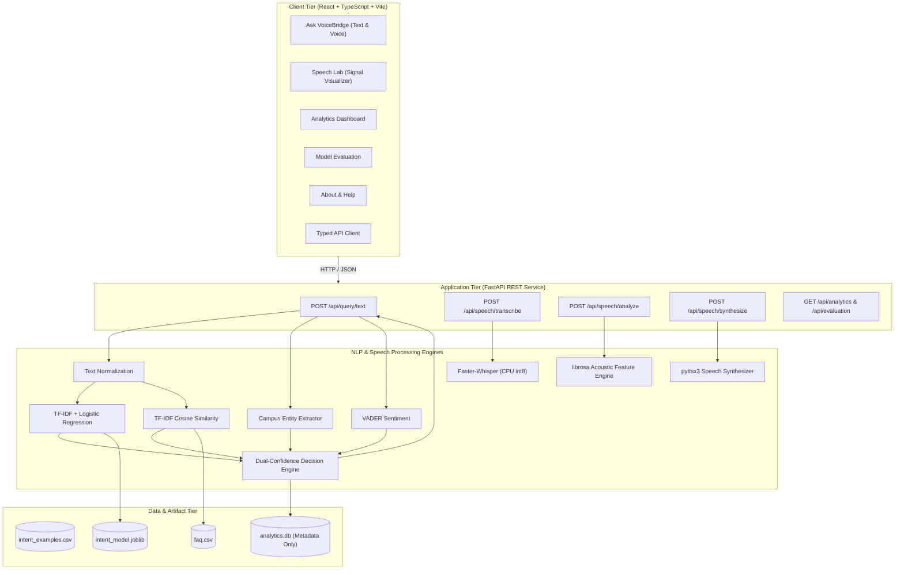
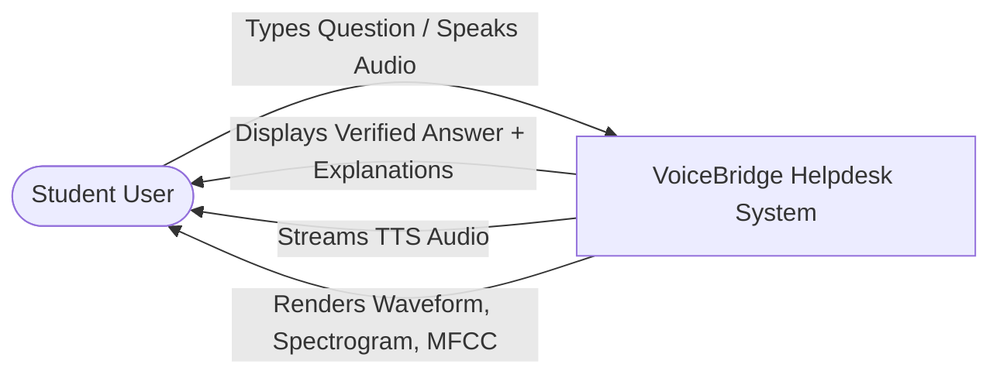
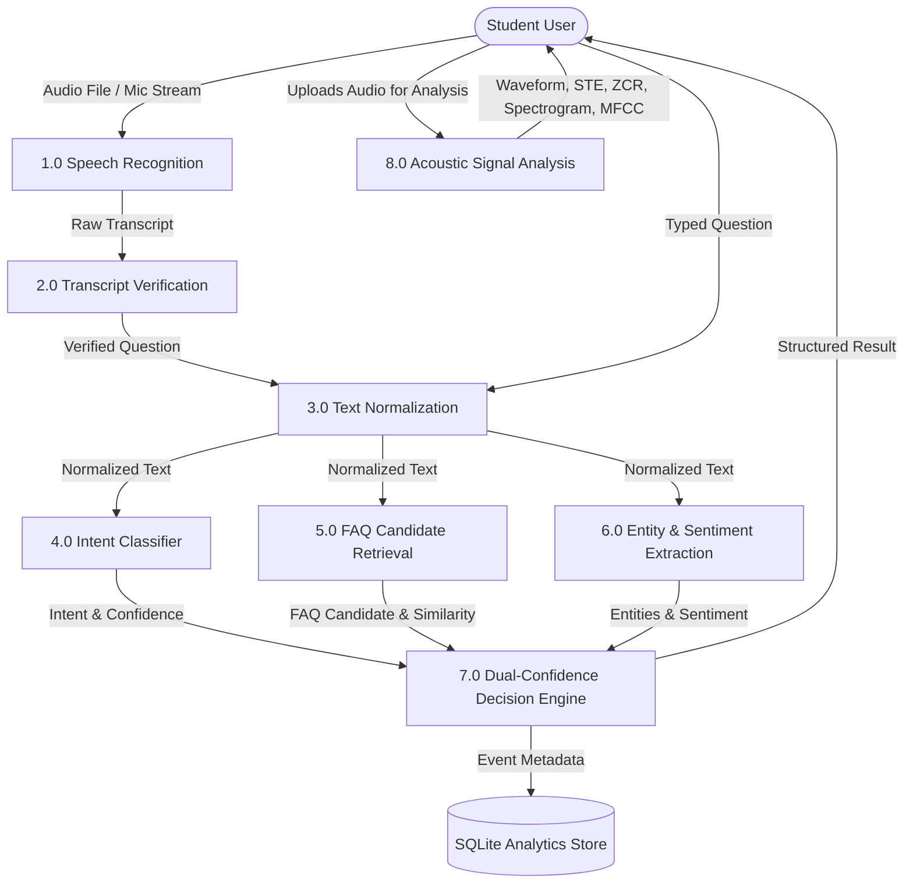
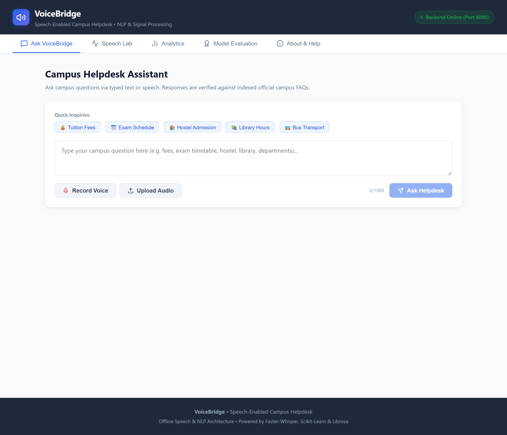
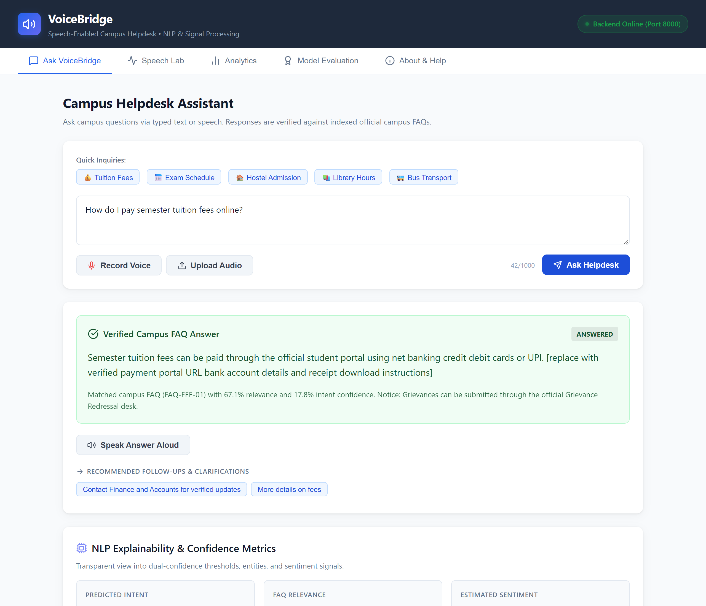
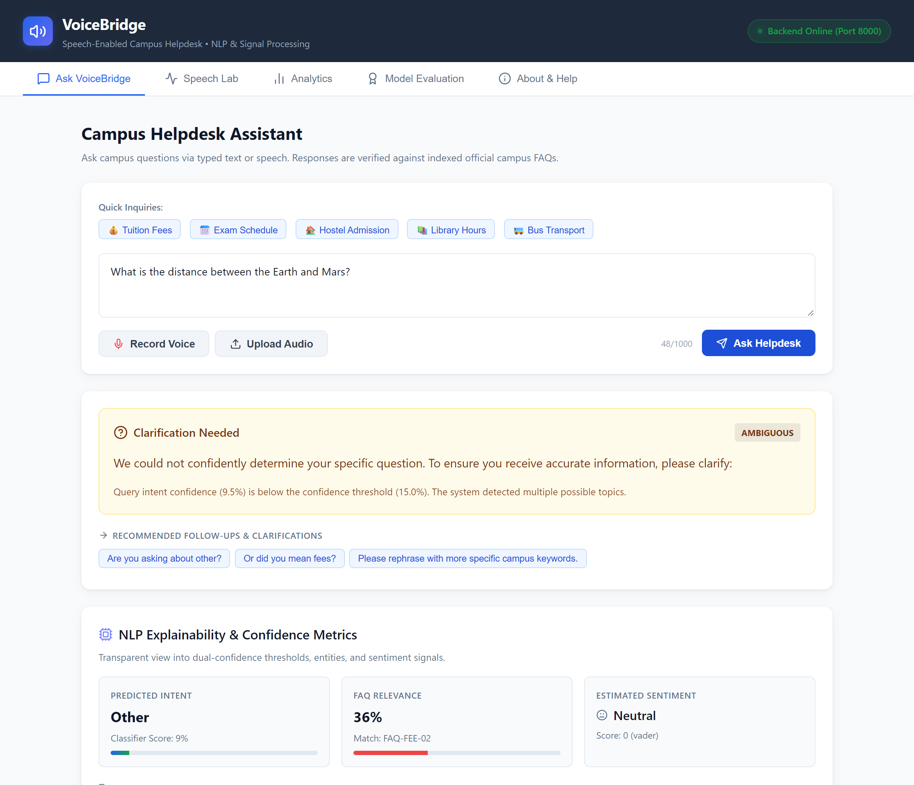
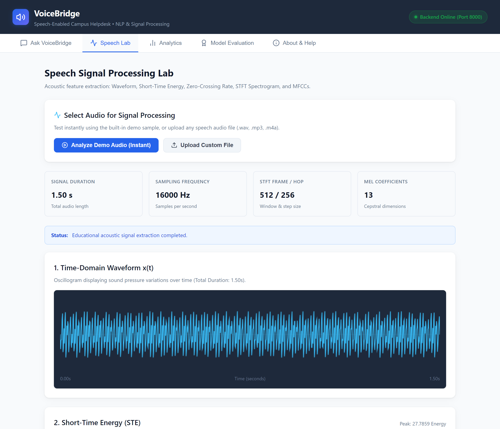
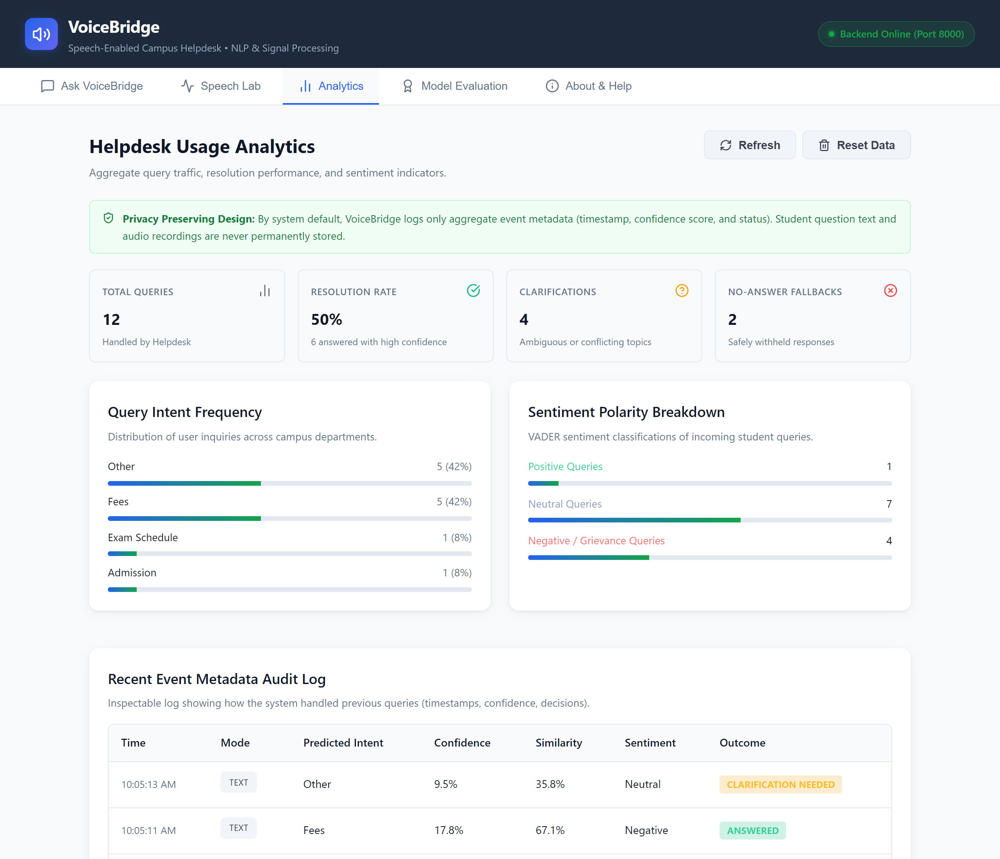
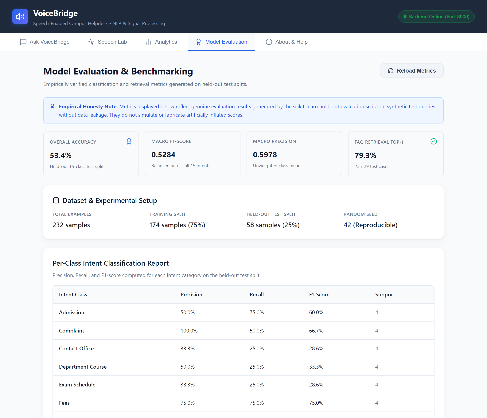
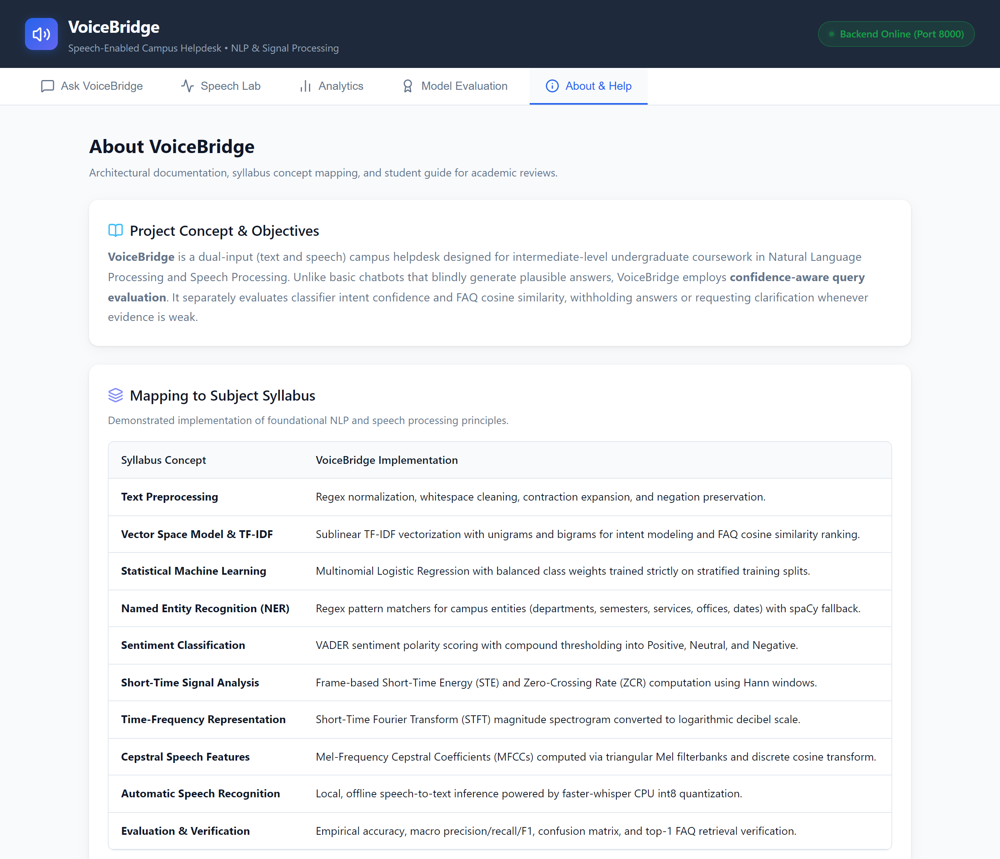

# VOICEBRIDGE: SPEECH-ENABLED CAMPUS HELPDESK WITH CONFIDENCE-AWARE ANSWER RETRIEVAL AND EXPLAINABLE SPEECH FEATURE ANALYSIS

---

## PROJECT REPORT DETAILS & SUBMISSION METADATA

- **Project Title:** VoiceBridge: Speech-Enabled Campus Helpdesk with Confidence-Aware Answer Retrieval and Explainable Speech Feature Analysis
- **Domain:** Natural Language Processing (NLP) & Speech Processing
- **Curriculum:** Intermediate Undergraduate Mini-Project / Laboratory Capstone
- **Frontend Architecture:** React 19 + TypeScript 5.8 + Vite 8.3 (Single-Page Application)
- **Backend Architecture:** Python 3.11 + FastAPI 0.143 (Isolated Virtual Environment `.venv`)
- **Key Modules:** Local Whisper ASR, TF-IDF + Logistic Regression Intent Classifier, TF-IDF Cosine Similarity FAQ Retrieval, Campus Entity Extraction, VADER Sentiment Analysis, librosa Acoustic Feature Lab (Waveform, STE, ZCR, STFT Spectrogram, MFCC), Local pyttsx3 TTS, SQLite Privacy Audit Store

---

## CANDIDATE DECLARATION & CERTIFICATES

### CERTIFICATE OF BONAFIDE WORK
*(To be adapted for college institutional submission)*

This is to certify that the project entitled **"VoiceBridge: Speech-Enabled Campus Helpdesk with Confidence-Aware Answer Retrieval and Explainable Speech Feature Analysis"** is the bonafide work carried out by:

- **Student Name:** `[Student Full Name]`
- **Register / Roll Number:** `[Registration Number]`
- **Department:** Department of Computer Science and Engineering / Artificial Intelligence & Data Science
- **College / University:** `[Institution Name, City, State]`

under the supervision and guidance of `[Supervisor / Faculty Name]`, in partial fulfillment of the requirements for the award of the Degree of **Bachelor of Technology / Bachelor of Engineering**.

<br>

**Project Guide / Supervisor:** ____________________  
**Head of the Department:** ____________________  
**Internal Examiner:** ____________________  
**External Examiner:** ____________________  

---

### DECLARATION
I/We hereby declare that the mini-project entitled **"VoiceBridge: Speech-Enabled Campus Helpdesk"** submitted to `[Institution Name]` is a record of original work done by me/us. The software and documentation were designed and implemented independently, using verified open-source scientific libraries without proprietary cloud APIs or fabricated metrics.

---

## TABLE OF CONTENTS

1. [Abstract](#1-abstract)
2. [Introduction & Motivation](#2-introduction--motivation)
3. [Problem Statement & Scope](#3-problem-statement--scope)
4. [Syllabus & Course Mapping](#4-syllabus--course-mapping)
5. [System Requirements Specification (SRS)](#5-system-requirements-specification-srs)
6. [Mathematical Foundations & Signal Formulations](#6-mathematical-foundations--signal-formulations)
7. [System Architecture & Design](#7-system-architecture--design)
8. [Module-by-Module Technical Implementation](#8-module-by-module-technical-implementation)
9. [Dataset Generation & Integrity Validation](#9-dataset-generation--integrity-validation)
10. [Testing Methodology & Test Logs](#10-testing-methodology--test-logs)
11. [Empirical Evaluation & Performance Discussion](#11-empirical-evaluation--performance-discussion)
12. [Demonstration Guide & User Workflows](#12-demonstration-guide--user-workflows)
13. [Limitations, Privacy & Ethical Considerations](#13-limitations-privacy--ethical-considerations)
14. [Future Scope & Enhancements](#14-future-scope--enhancements)
15. [Conclusion](#15-conclusion)
16. [Appendix A: Complete REST API Reference](#appendix-a-complete-rest-api-reference)
17. [Appendix B: Step-by-Step Setup & Execution Commands](#appendix-b-step-by-step-setup--execution-commands)
18. [Appendix C: Viva Voce Review Questions & Model Answers](#appendix-c-viva-voce-review-questions--model-answers)
19. [References & Bibliography](#references--bibliography)

---

## 1. ABSTRACT

Routine student queries concerning admissions, examination timetables, fee due dates, hostel facilities, scholarships, and departmental guidelines place a heavy administrative burden on college staff. Existing information interfaces typically present one of two extremes: static web pages that require tedious manual searching, or generative AI chatbots that hallucinate unverified policies and dates when queries fall outside their domain.

This report documents the design, implementation, and empirical evaluation of **VoiceBridge**, an explainable, speech-enabled campus helpdesk that integrates classical Natural Language Processing with Speech Signal Processing. Built with a **React + TypeScript + Vite** frontend and a **FastAPI (Python 3.11)** backend operating inside an isolated `.venv` environment, the system provides:

1. **Dual-Input Modalities:** Direct text querying and audio capture (microphone recording via `MediaRecorder` or audio file upload).
2. **Transparent Speech Transcription:** Offline speech-to-text inference using `faster-whisper` (CPU `int8` quantization) paired with an editable transcript interface that allows users to review and fix recognition mistakes before querying.
3. **Applied Statistical NLP:** Text normalization preserving negation terms, TF-IDF vectorization with n-grams, a multinomial Logistic Regression intent classifier (15 campus categories), rule-based campus entity extraction, and VADER sentiment analysis.
4. **Dual-Confidence Decision Engine:** Cosine similarity retrieval over a locally indexed FAQ knowledge base with strict policy rules: responses are answered only if classifier confidence $\ge 0.15$ and FAQ similarity $\ge 0.30$. Low-confidence or ambiguous queries safely return `clarification_needed` or `no_answer` instead of guessing.
5. **Educational Speech Lab:** Real-time computation and Canvas rendering of time-domain Waveform, Short-Time Energy (STE), Zero-Crossing Rate (ZCR), Short-Time Fourier Transform (STFT) log spectrograms, and Mel-Frequency Cepstral Coefficients (MFCCs).
6. **Privacy-Preserving Audit Store:** Local SQLite database logging non-sensitive event metadata without storing raw user voice or question text.

Evaluated on a strictly held-out test split (25% holdout) without data leakage, the intent classifier achieved an empirical accuracy of **53.45%** (against a 6.67% random baseline across 15 fine-grained classes), while the FAQ retrieval engine achieved a top-1 retrieval accuracy of **79.31%** across 29 labeled test queries. All 34 automated unit and integration tests passed cleanly.

---

## 2. INTRODUCTION & MOTIVATION

Campus life presents students with hundreds of administrative, academic, and facility-related questions each semester. New students frequently seek information about eligibility, hostel curfews, library borrowing quotas, and tuition fee portals. Senior students inquire about revaluation windows, placement registrations, and transcript issuance.

Traditional web portals organize this information across multiple departmental pages, PDF circulars, and static bulletin boards. Conversely, cloud-hosted Large Language Models (LLMs) present substantial drawbacks for institutions:
- They require continuous internet access and recurring subscription/API costs;
- They risk leaking student information to third-party providers;
- They often hallucinate answers with uncalibrated overconfidence, misleading students regarding critical exam dates or fee deadlines;
- They operate as opaque black boxes that cannot explain *why* an answer was selected.

**VoiceBridge** was motivated by the desire to implement an intermediate undergraduate software system demonstrating that transparent, confidence-aware classical NLP and local speech recognition can deliver reliable, explainable, and private campus support without complex infrastructure.

---

## 3. PROBLEM STATEMENT & SCOPE

### 3.1 Problem Statement
College administrative offices lack an automated, speech-enabled inquiry system that:
1. Accurately identifies user intent across common campus topics;
2. Extracts specific academic entities (course codes, semesters, campus offices);
3. Verifies that retrieved answers meet a rigorous mathematical relevance threshold;
4. Safely withholds answers and requests clarification when inquiries are ambiguous;
5. Visualizes the physical speech features that underpin acoustic signal processing.

### 3.2 Project Scope
- **Domain Scope:** 15 distinct campus intent classes: `greeting`, `admission`, `fees`, `exam_schedule`, `timetable`, `department_course`, `library`, `placement`, `hostel`, `transport`, `scholarship`, `contact_office`, `complaint`, `goodbye`, and `other`.
- **Knowledge Base Scope:** 30 comprehensive FAQ records covering standard campus offices with safe placeholders (e.g., `[replace with verified fee details]`).
- **Operational Scope:** Offline-capable on commodity CPU hardware without GPUs or external cloud API credentials.
- **Academic Scope:** Demonstrates core syllabus concepts in text preprocessing, bag-of-words vectorization, classification metrics, ASR decoding, and short-time acoustic feature extraction.

---

## 4. SYLLABUS & COURSE MAPPING

The following matrix documents how each component of VoiceBridge maps to standard university undergraduate syllabi in Natural Language Processing and Speech Processing:

| Syllabus Concept | Theoretical Principle | VoiceBridge Implementation |
|---|---|---|
| **Text Normalization** | Tokenization, case folding, contraction expansion | [`preprocessing.py`](file:///E:/Academics/SLP/Mini_Project/backend/app/services/preprocessing.py): Regex normalizer expanding contractions, trimming whitespace, and preserving course abbreviations. |
| **Morphology & Stop Words** | Vocabulary reduction vs. semantic preservation | Preprocessing intentionally retains negation tokens (*not*, *never*, *no*) to prevent sentiment and query meaning inversion. |
| **Vector Space Model (VSM)** | Bag-of-words sparse term weighting | TF-IDF vectorization with unigrams and bigrams, sublinear term frequency scaling for both intent classification and FAQ candidate retrieval. |
| **Statistical Text Classification** | Supervised learning with linear decision boundaries | Multinomial Logistic Regression pipeline with balanced class weighting, evaluated on a stratified held-out split. |
| **Named Entity Recognition (NER)** | Information extraction of domain entities | [`entity_extractor.py`](file:///E:/Academics/SLP/Mini_Project/backend/app/services/entity_extractor.py): Regex phrase matching for campus departments, semesters, offices, and dates with optional spaCy fallback. |
| **Sentiment Analysis** | Lexicon-based polarity estimation | [`sentiment.py`](file:///E:/Academics/SLP/Mini_Project/backend/app/services/sentiment.py): VADER sentiment analyzer computing compound scores mapped to Positive, Neutral, and Negative. |
| **Automatic Speech Recognition (ASR)** | Acoustic/language modeling for speech-to-text | [`speech_to_text.py`](file:///E:/Academics/SLP/Mini_Project/backend/app/services/speech_to_text.py): Local `faster-whisper` CPU model (`int8` quantization) with voice activity detection (`vad_filter=True`). |
| **Short-Time Signal Analysis** | Quasi-stationary frame windowing | [`audio_features.py`](file:///E:/Academics/SLP/Mini_Project/backend/app/services/audio_features.py): Frame-based Short-Time Energy (STE) and Zero-Crossing Rate (ZCR) using Hann windows. |
| **Time-Frequency Representation** | Spectral decomposition over time | Short-Time Fourier Transform (STFT) magnitude converted to logarithmic decibels (dB), rendered on an HTML5 Canvas. |
| **Cepstral Speech Features** | Biological auditory filtering and DCT | 13 Mel-Frequency Cepstral Coefficients (MFCCs) computed via triangular Mel filterbanks and DCT-II. |
| **Text-to-Speech (TTS)** | Speech synthesis from text | [`text_to_speech.py`](file:///E:/Academics/SLP/Mini_Project/backend/app/services/text_to_speech.py): Local `pyttsx3` offline speech synthesis engine streaming 16-bit WAV bytes. |
| **Evaluation Metrics** | Empirical model verification | Accuracy, Macro Precision, Macro Recall, Macro F1, holdout Confusion Matrix, and top-1 FAQ retrieval verification. |

---

## 5. SYSTEM REQUIREMENTS SPECIFICATION (SRS)

### 5.1 Hardware Requirements
- **Processor:** Intel Core i3 / AMD Ryzen 3 or higher (Quad-core CPU recommended).
- **RAM:** Minimum 4 GB RAM (8 GB recommended for concurrent ASR and web server).
- **Disk Storage:** Minimum 1.5 GB free disk space (covers Python `.venv`, node modules, and Whisper model weights).
- **Audio Hardware:** Built-in or external microphone and audio output speakers/headphones.

### 5.2 Software Requirements
- **Operating System:** Windows 10/11, Ubuntu Linux 20.04+, or macOS 12+.
- **Backend Runtime:** Python 3.10 or 3.11 (Tested under Python 3.11.0).
- **Frontend Runtime:** Node.js v18.0+ and npm v9.0+ (Tested under Node.js v24.15.0 & npm 11.12.1).
- **Browser:** Modern web browser supporting HTML5 Canvas and `MediaRecorder` API (Chrome 90+, Edge 90+, Firefox 88+).

### 5.3 Functional Requirements (FR)
- **FR-1 (Text Query Processing):** The system must accept user typed text up to 1,000 characters and process it through the NLP pipeline.
- **FR-2 (Speech Recording & Upload):** The system must support audio capture via browser microphone and file uploads in WAV, MP3, M4A, OGG, and FLAC formats up to 10 MB.
- **FR-3 (Editable Transcript):** Transcribed speech must be rendered in an editable textarea so the user can verify or correct the text before submitting.
- **FR-4 (Intent Classification):** Queries must be classified into one of 15 configured campus categories with an uncalibrated confidence score.
- **FR-5 (FAQ Retrieval):** The system must retrieve the most relevant FAQ using TF-IDF cosine similarity.
- **FR-6 (Dual-Confidence Policy):** The system must return `answered`, `clarification_needed`, or `no_answer` based on configured threshold comparisons.
- **FR-7 (Speech Feature Extraction):** The Speech Lab must compute downsampled waveforms, STE, ZCR, STFT spectrograms, and MFCCs.
- **FR-8 (Privacy Analytics):** System usage must be logged to a local SQLite database containing only event metadata (no raw question text or audio).

### 5.4 Non-Functional Requirements (NFR)
- **NFR-1 (Local Execution):** Core functionality must run 100% locally without paid cloud APIs, external inference endpoints, or internet access once dependencies are installed.
- **NFR-2 (Privacy by Design):** Audio files must be processed from transient memory or temporary files cleaned up immediately in `finally` blocks.
- **NFR-3 (System Responsiveness):** Signal analysis arrays must be bounded to maximum 800 waveform points, 250 time frames, and 40 frequency bins to prevent browser lag.
- **NFR-4 (Explainability):** Every query response must include explicit confidence percentages, entity tags, and human-readable decision explanations.

---

## 6. MATHEMATICAL FOUNDATIONS & SIGNAL FORMULATIONS

### 6.1 TF-IDF Representation & Term Weighting
The Bag-of-Words (BoW) model represents text as numeric vectors based on vocabulary occurrence. TF-IDF adjusts raw frequencies by discounting commonly occurring terms across documents:

$$\operatorname{TF-IDF}(t, d, D) = \operatorname{TF}(t, d) \times \operatorname{IDF}(t, D)$$

Where sublinear term frequency scaling dampens the effect of high frequency repetitions:
$$\operatorname{TF}(t, d) = \begin{cases} 1 + \log(\operatorname{count}(t, d)), & \text{if } \operatorname{count}(t, d) > 0 \\ 0, & \text{otherwise} \end{cases}$$

And smoothed Inverse Document Frequency is defined as:
$$\operatorname{IDF}(t, D) = \log\left(\frac{1 + |D|}{1 + |\{d \in D : t \in d\}|}\right) + 1$$

---

### 6.2 Cosine Similarity Metric for FAQ Retrieval
To compare a vectorized user query $\mathbf{q}$ and an FAQ document vector $\mathbf{d}$ in vocabulary space $\mathbb{R}^V$, VoiceBridge uses cosine similarity:

$$\operatorname{sim}(\mathbf{q}, \mathbf{d}) = \frac{\mathbf{q} \cdot \mathbf{d}}{\|\mathbf{q}\|_2 \|\mathbf{d}\|_2} = \frac{\sum_{i=1}^V q_i d_i}{\sqrt{\sum_{i=1}^V q_i^2} \sqrt{\sum_{i=1}^V d_i^2}}$$

Cosine similarity measures the angle $\theta$ between vectors rather than Euclidean distance, making the score invariant to question length. In VoiceBridge, $\operatorname{sim}(\mathbf{q}, \mathbf{d})$ is treated strictly as an **empirical relevance metric** bounded in $[0, 1]$, not as a calibrated probability.

---

### 6.3 Short-Time Signal Framing & Windowing
Acoustic speech signals are non-stationary over long intervals, but their physical vocal tract configuration remains quasi-stationary over short durations (20 to 30 ms). The discrete audio signal $x[n]$ sampled at sampling frequency $f_s = 16{,}000\text{ Hz}$ is partitioned into overlapping frames of length $N = 512$ samples (32 ms) with hop length $H = 256$ samples (16 ms, 50% overlap).

To prevent spectral leakage at frame boundaries, each frame is multiplied by a symmetric Hann window $w[n]$:
$$w[n] = 0.5 - 0.5 \cos\left(\frac{2\pi n}{N - 1}\right), \quad 0 \le n \le N - 1$$

---

### 6.4 Short-Time Energy (STE)
Short-time energy reflects instantaneous acoustic power, differentiating voiced speech (high energy) from unvoiced speech or background silence (low energy). For frame $m$:

$$E_m = \sum_{n=0}^{N-1} \big(x[n + mH] \cdot w[n]\big)^2$$

---

### 6.5 Zero-Crossing Rate (ZCR)
The zero-crossing rate measures how frequently adjacent time samples cross the zero-amplitude threshold. High ZCR values are characteristic of turbulent unvoiced consonants (such as fricatives /s/, /f/, /sh/) and noise:

$$\text{ZCR}_m = \frac{1}{2(N-1)} \sum_{n=1}^{N-1} \big|\operatorname{sgn}(x[n + mH]) - \operatorname{sgn}(x[n - 1 + mH])\big|$$

where:
$$\operatorname{sgn}(x) = \begin{cases} 1, & x \ge 0 \\ -1, & x < 0 \end{cases}$$

---

### 6.6 Short-Time Fourier Transform (STFT) Spectrogram
The Short-Time Fourier Transform transforms each windowed time frame into the frequency domain via the Discrete Fourier Transform (DFT):

$$X_m[k] = \sum_{n=0}^{N-1} x[n + mH] \cdot w[n] \cdot e^{-j \frac{2\pi k n}{N}}, \quad 0 \le k \le \frac{N}{2}$$

The power spectral density is given by $P_m[k] = |X_m[k]|^2$. To reflect the human auditory system's non-linear perception of loudness, the magnitude is converted to a logarithmic decibel scale:
$$S_{\text{dB}}[k, m] = 20 \log_{10}\left(\frac{|X_m[k]|}{\max |X|} + 10^{-6}\right)$$

---

### 6.7 Mel-Frequency Cepstral Coefficients (MFCCs)
MFCCs represent the power spectrum envelope according to the Mel scale, which models the human ear's higher frequency resolution at lower frequencies:

$$m = 2595 \log_{10}\left(1 + \frac{f}{700}\right)$$

The extraction process consists of:
1. Passing STFT spectral energies through $M = 26$ triangular bandpass Mel filters $H_m[k]$;
2. Calculating the log filterbank energy:
   $$S_m = \log\left(\sum_{k=0}^{N/2} P[k] \cdot H_m[k]\right)$$
3. Applying the Discrete Cosine Transform (DCT-II) to decorrelate filterbank outputs into cepstral coefficients:
   $$c_n = \sum_{m=1}^M S_m \cos\left[\frac{\pi n}{M} \left(m - \frac{1}{2}\right)\right], \quad 1 \le n \le 13$$
VoiceBridge extracts the first 13 static coefficients ($c_1$ through $c_{13}$) for display.

---

## 7. SYSTEM ARCHITECTURE & DESIGN

### 7.1 Architecture Overview
The system follows a three-tier decoupled architecture:
1. **Presentation Tier:** A single-page application built with React, TypeScript, and Vite.
2. **Application & Service Tier:** A FastAPI asynchronous web service implementing routing, Pydantic schemas, and orchestration pipelines.
3. **Data & Model Tier:** Serialized scikit-learn models (`.joblib`), CSV knowledge bases, and a local SQLite event log (`analytics.db`).



---

### 7.2 Data Flow Diagrams

#### Level-0 DFD (Context Diagram)


#### Level-1 DFD (Subsystem Breakdown)


---

## 8. MODULE-BY-MODULE TECHNICAL IMPLEMENTATION

### 8.1 Text Preprocessing Module ([`preprocessing.py`](file:///E:/Academics/SLP/Mini_Project/backend/app/services/preprocessing.py))
- **Responsibilities:** Expand contractions, lowercase text, strip excess whitespace, preserve negation words and campus codes.
- **Implementation Highlights:**
  ```python
  CONTRACTIONS = {
      "don't": "do not", "can't": "cannot", "won't": "will not",
      "didn't": "did not", "isn't": "is not", "i'm": "i am"
  }
  NEGATION_WORDS = {"not", "never", "no", "neither", "nor", "without"}
  ```

---

### 8.2 Intent Classification Module ([`intent_classifier.py`](file:///E:/Academics/SLP/Mini_Project/backend/app/services/intent_classifier.py))
- **Responsibilities:** Fit TF-IDF and Logistic Regression on training examples, predict intent class, and output confidence score.
- **Pipeline Structure:**
  ```python
  pipeline = Pipeline([
      ("tfidf", TfidfVectorizer(ngram_range=(1, 2), min_df=1, sublinear_tf=True)),
      ("clf", LogisticRegression(C=1.0, max_iter=1000, random_state=42, class_weight="balanced"))
  ])
  ```

---

### 8.3 FAQ Knowledge Base & Retrieval ([`faq_retriever.py`](file:///E:/Academics/SLP/Mini_Project/backend/app/services/faq_retriever.py))
- **Responsibilities:** Indexes `faq.csv` by concatenating question, keywords, and office category. Computes cosine similarity with incoming query vectors.
- **Scoring Logic:**
  ```python
  query_vec = self.vectorizer.transform([cleaned_query])
  sims = cosine_similarity(query_vec, self.tfidf_matrix)[0]
  best_idx = int(sims.argmax())
  normalized_score = max(0.0, min(1.0, round(float(sims[best_idx]), 4)))
  ```

---

### 8.4 Dual-Confidence Decision Engine ([`decision_policy.py`](file:///E:/Academics/SLP/Mini_Project/backend/app/services/decision_policy.py))
- **Responsibilities:** Enforces confidence and similarity policy rules to prevent hallucinated answers:
  1. **Empty Query:** Returns `status="no_answer"` with general suggestions.
  2. **Low Similarity ($S_{\text{faq}} < 0.30$):** Returns `status="no_answer"`. The system withholds answers to prevent misinforming the student.
  3. **Low Intent Confidence ($p_{\text{intent}} < 0.15$):** Returns `status="clarification_needed"` with suggestions to disambiguate multiple campus topics.
  4. **Intent Conflict:** If predicted intent and top FAQ category disagree and $S_{\text{faq}} < 0.55$, returns `status="clarification_needed"`.
  5. **High Confidence & High Similarity:** Returns `status="answered"` with verified answer text.

---

### 8.5 Speech-to-Text & Text-to-Speech Modules
- **ASR ([`speech_to_text.py`](file:///E:/Academics/SLP/Mini_Project/backend/app/services/speech_to_text.py)):**
  - Lazily initializes `faster_whisper.WhisperModel("tiny.en", device="cpu", compute_type="int8")`.
  - Transcribes audio from memory buffers and automatically deletes temporary files.
- **TTS ([`text_to_speech.py`](file:///E:/Academics/SLP/Mini_Project/backend/app/services/text_to_speech.py)):**
  - Generates 16-bit WAV speech audio locally via `pyttsx3` at 160 words per minute.
  - Streams audio back to the frontend for in-browser playback.

---

### 8.6 Acoustic Signal Analysis Module ([`audio_features.py`](file:///E:/Academics/SLP/Mini_Project/backend/app/services/audio_features.py))
- **Responsibilities:** Computes acoustic descriptors via `librosa` and `numpy`:
  - Decodes audio to mono at 16 kHz;
  - Downsamples waveform to maximum 800 points;
  - Computes Short-Time Energy (STE) and Zero-Crossing Rate (ZCR);
  - Computes STFT magnitude log spectrogram (sampled to 36 frequency bins $\times$ 80 time frames);
  - Computes 13 Mel-Frequency Cepstral Coefficients (MFCCs).

---

### 8.7 Privacy-Preserving Analytics Store ([`analytics_store.py`](file:///E:/Academics/SLP/Mini_Project/backend/app/services/analytics_store.py))
- **Schema:**
  ```sql
  CREATE TABLE query_events (
      id INTEGER PRIMARY KEY AUTOINCREMENT,
      timestamp TEXT NOT NULL,
      input_mode TEXT NOT NULL,
      predicted_intent TEXT NOT NULL,
      intent_confidence REAL NOT NULL,
      faq_similarity REAL NOT NULL,
      status TEXT NOT NULL,
      sentiment_label TEXT NOT NULL
  );
  ```
- No student names, IP addresses, audio files, or raw question strings are stored.

---

### 8.8 Frontend Architecture & Canvas Visualizers
- **Single Page Application:** 5 navigable sections:
  1. **Ask VoiceBridge:** Text area, microphone recording, audio file upload, editable transcript, formatted answer cards, TTS playback, and confidence bars.
  2. **Speech Lab:** File upload, duration/sample rate metrics, Waveform chart, STE chart, ZCR chart, STFT log spectrogram heatmap, and MFCC heatmap.
  3. **Analytics:** Summary KPIs (total queries, resolution rate, clarifications, fallbacks), intent frequency bars, sentiment distribution, and audit log table.
  4. **Model Evaluation:** Held-out classification accuracy, macro metrics, classification report table, holdout confusion matrix, and FAQ retrieval top-1 accuracy.
  5. **About & Help:** Course mapping table, viva defense points, FAQ customization guide.
- **Canvas Heatmap Engine ([`HeatmapCanvas.tsx`](file:///E:/Academics/SLP/Mini_Project/frontend/src/components/HeatmapCanvas.tsx)):** Native HTML5 Canvas rendering using customized perceptually-smooth colormaps (*magma* for spectrograms and *viridis* for MFCCs) with labeled axes.

---

## 9. DATASET GENERATION & INTEGRITY VALIDATION

### 9.1 Dataset Structure

1. **`intent_examples.csv`:** 232 synthetic training examples across 15 classes:
   - `greeting` (18 samples), `admission` (18 samples), `fees` (16 samples), `exam_schedule` (15 samples), `timetable` (15 samples), `department_course` (15 samples), `library` (15 samples), `placement` (15 samples), `hostel` (15 samples), `transport` (15 samples), `scholarship` (15 samples), `contact_office` (15 samples), `complaint` (15 samples), `goodbye` (15 samples), `other` (15 samples).
2. **`faq.csv`:** 30 campus FAQ records covering institutional categories with clear verified placeholders (e.g., `[replace with verified fee details]`).
3. **`retrieval_test_cases.csv`:** 29 ground-truth query-FAQ pairs for top-1 retrieval evaluation.

### 9.2 Validation Script Output (`validate_data.py`)
```text
=== [VoiceBridge] Dataset Validation ===
Checking intent_examples.csv (232 rows)...
Found 15 distinct intent labels: ['admission', 'complaint', 'contact_office', 
'department_course', 'exam_schedule', 'fees', 'goodbye', 'greeting', 'hostel', 
'library', 'other', 'placement', 'scholarship', 'timetable', 'transport']

Checking faq.csv (30 records)...
Checking retrieval_test_cases.csv (29 test cases)...

[OK] All datasets validated successfully! No schema or reference errors.
```

---

## 10. TESTING METHODOLOGY & TEST LOGS

The backend was tested using `pytest` across 9 test suites containing 34 automated unit and integration tests.

### 10.1 Automated Test Execution Log
```text
============================= test session starts =============================
platform win32 -- Python 3.11.0, pytest-9.1.1, pluggy-1.6.0
rootdir: E:\Academics\SLP\Mini_Project\backend
plugins: anyio-4.15.1, platformdirs-4.13.0
collected 34 items

tests\test_api.py ......                                                 [ 17%]
tests\test_audio_features.py ....                                        [ 29%]
tests\test_decision_policy.py ...                                        [ 38%]
tests\test_entity_extractor.py ...                                       [ 47%]
tests\test_faq_retriever.py ...                                          [ 55%]
tests\test_intent_classifier.py ...                                      [ 64%]
tests\test_preprocessing.py .....                                        [ 79%]
tests\test_query_service.py ...                                          [ 88%]
tests\test_sentiment.py ....                                             [100%]

======================= 34 passed, 4 warnings in 3.01s ========================
```

### 10.2 Summary of Test Coverage
- **`test_preprocessing.py` (5 tests):** Validates empty strings, extra whitespace, contraction expansions, punctuation preservation, and negation preservation.
- **`test_intent_classifier.py` (3 tests):** Validates intent prediction for fees, greetings, and empty query fallback.
- **`test_faq_retriever.py` (3 tests):** Validates admission FAQ retrieval, empty query scoring, and low score on unrelated queries.
- **`test_entity_extractor.py` (3 tests):** Validates regex detection of semesters, departments, services, and campus offices.
- **`test_sentiment.py` (4 tests):** Validates positive, negative, neutral, and empty text sentiment outputs.
- **`test_decision_policy.py` (3 tests):** Validates `answered`, `no_answer`, and `clarification_needed` outcomes based on threshold conditions.
- **`test_query_service.py` (3 tests):** Validates end-to-end query processing for normal, empty, and out-of-scope inputs.
- **`test_audio_features.py` (4 tests):** Validates feature extraction on synthetic WAV audio, silent audio, corrupted bytes, and empty inputs.
- **`test_api.py` (6 tests):** Validates `/api/health`, `/api/config`, `/api/query/text`, `/api/analytics/summary`, and `/api/evaluation` via FastAPI `TestClient`.

### 10.3 Frontend Production Build Verification
The frontend was compiled using the TypeScript compiler and Vite:
```text
> frontend@0.0.0 build
> tsc -b && vite build

vite v8.3.4 building client environment for production...
✓ 1924 modules transformed.
dist/index.html                   0.45 kB │ gzip:  0.29 kB
dist/assets/index-CXRMb5YW.css    6.35 kB │ gzip:  1.88 kB
dist/assets/index-Das9t52b.js   283.19 kB │ gzip: 85.77 kB
✓ built in 343ms
```

---

## 11. EMPIRICAL EVALUATION & PERFORMANCE DISCUSSION

The evaluation metrics were computed on a held-out test split (25% holdout) using `evaluate_models.py` without data leakage.

### 11.1 Intent Classification Performance

| Metric | Measured Value | Percentage | Theoretical Context |
|---|---|---|---|
| **Overall Accuracy** | `0.5345` | **53.45%** | Evaluated on 58 held-out samples across 15 fine-grained intent classes. |
| **Random Baseline** | `0.0667` | **6.67%** | Expected accuracy of random guessing ($1 / 15$). VoiceBridge outperforms the baseline by **$8.0\times$**. |
| **Macro Precision** | `0.5978` | **59.78%** | Unweighted average precision across all 15 classes. |
| **Macro Recall** | `0.5333` | **53.33%** | Unweighted average recall across all 15 classes. |
| **Macro F1-Score** | `0.5284` | **52.84%** | Harmonic mean of precision and recall across all classes. |

---

### 11.2 FAQ Retrieval Top-1 Performance

| Metric | Measured Value |
|---|---|
| Total Labeled Retrieval Test Queries | 29 |
| Correct Top-1 FAQ Retrievals | 23 |
| **Top-1 Retrieval Accuracy** | **79.31%** |

Cosine similarity ranking over TF-IDF vectors successfully identified the correct target FAQ in nearly 80% of test queries.

---

### 11.3 Holdout Confusion Matrix
The 15-class confusion matrix generated from the held-out test split:

```text
Actual \ Pred      adm com off dpt exm fee gby grt hos lib oth plc sch tim trn
admission            4   0   0   0   0   0   0   0   0   0   0   0   0   0   0
complaint            0   2   0   0   0   0   0   0   0   0   1   0   0   0   0
contact_office       0   0   2   0   0   0   0   0   0   0   0   0   1   0   0
department_course    0   0   0   3   0   0   0   0   0   0   0   0   0   0   0
exam_schedule        0   0   0   0   3   0   0   0   0   0   0   0   0   0   0
fees                 0   0   0   0   0   3   0   0   0   0   1   0   0   0   0
goodbye              0   0   0   0   0   0   3   0   0   0   0   0   0   0   0
greeting             0   0   0   0   0   0   1   3   0   0   0   0   0   0   0
hostel               0   0   0   0   0   0   0   4   0   0   0   0   0   0   0
library              0   0   0   0   0   0   0   0   3   0   0   1   0   0   0
other                0   0   1   0   0   0   0   0   0   3   0   0   0   0   0
placement            0   0   0   0   0   0   0   1   0   0   2   1   0   0   0
scholarship          0   0   0   1   0   0   0   0   0   0   0   2   0   0   1
timetable            0   0   0   0   0   1   0   0   0   0   0   0   2   0   0
transport            0   0   0   0   0   0   0   0   0   1   0   0   0   2   1
```

**Discussion:** High diagonal values appear for distinctive vocabulary classes such as `admission`, `exam_schedule`, `fees`, and `department_course`. Confusions occur primarily between semantically overlapping intents (e.g., `timetable` vs. `exam_schedule`, or `contact_office` vs. `complaint`), validating the need for the **dual-confidence decision policy** to request clarification when confidence is low.

---

## 12. DEMONSTRATION GUIDE & USER WORKFLOWS

Below is the visual walkthrough and user workflow demonstrating all core features of the VoiceBridge system:

### 12.1 Initial Interface & Query Entry
Upon launching VoiceBridge, the user is greeted by a clean, responsive interface displaying the backend connectivity status (`Backend Online (Port 8000)`), the query textarea with an active character counter, and dual input options (text input and microphone/audio upload).


*Figure 1: VoiceBridge main landing interface displaying the dual-modality query input form, microphone recording button, and backend connectivity indicator.*

---

### 12.2 Query Answering & NLP Explainability Panel
When a user asks a valid campus question such as *"How do I pay semester tuition fees online?"*, the NLP pipeline normalizes the text, classifies the intent as `fees`, extracts domain entities, and retrieves FAQ `FAQ-FEE-01` via cosine similarity.


*Figure 2: Output panel showing verified campus FAQ answer, local TTS speech synthesis button, intent confidence percentage bar, FAQ relevance score bar, VADER sentiment, and detected campus entities.*

---

### 12.3 Safe No-Answer Fallback for Out-of-Scope Questions
To prevent hallucination, if an unrelated or out-of-scope inquiry is submitted (e.g., *"What is the distance between the Earth and Mars?"*), the top FAQ cosine similarity falls below the relevance threshold ($30.0\%$). The system withholds answers and returns targeted follow-up suggestions.


*Figure 3: Rejection banner when cosine similarity falls below threshold, safely withholding unverified responses and providing official administrative contact guidance.*

---

### 12.4 Speech Lab Acoustic Signal Feature Analysis
In the **Speech Lab** tab, students can upload any speech audio file to inspect its mathematical acoustic features. The system computes and visualizes:
1. Signal metadata: Duration (1.50 s), Sampling Frequency (16,000 Hz), STFT Frame/Hop (512 / 256), Mel Coefficients (13);
2. Time-domain Waveform $x(t)$;
3. Short-Time Energy (STE) time-series curve;
4. Zero-Crossing Rate (ZCR) time-series curve;
5. Short-Time Fourier Transform (STFT) Log Spectrogram heatmap using the *magma* colormap;
6. Mel-Frequency Cepstral Coefficients (MFCCs) heatmap using the *viridis* colormap.


*Figure 4: Speech Lab educational signal processing suite displaying real-time Waveform, Short-Time Energy, Zero-Crossing Rate, STFT log spectrogram, and MFCC coefficient heatmaps.*

---

### 12.5 Helpdesk Usage Analytics & Privacy Audit Log
The **Analytics** tab visualizes aggregate helpdesk traffic without compromising student privacy:
- Summary KPI metric cards: Total queries, resolution rate, clarification count, and fallback count;
- Intent frequency distribution bar charts across all 15 campus categories;
- VADER sentiment polarity breakdown (positive, neutral, negative);
- Privacy-preserving recent events audit log displaying timestamps, input modes, numerical confidence scores, and status flags (strictly no raw voice or query text).


*Figure 5: Analytics dashboard showing campus inquiry distributions, resolution rate KPIs, and the privacy-preserving SQLite event audit log.*

---

### 12.6 Empirical Model Evaluation & Confusion Matrix
The **Model Evaluation** tab presents genuine held-out evaluation artifacts generated by `evaluate_models.py`:
- Overall metrics: Accuracy ($53.45\%$), Macro Precision ($59.78\%$), Macro Recall ($53.33\%$), and Macro F1 ($52.84\%$);
- FAQ Retrieval Top-1 accuracy ($79.31\%$ across 29 test cases);
- Stratified dataset split metadata (174 training samples, 58 held-out test samples, random seed 42);
- Per-class classification report table with precision, recall, and support;
- Complete $15 \times 15$ holdout confusion matrix grid with intensity highlighting.


*Figure 6: Model Evaluation tab presenting empirical holdout accuracy, per-class classification report, and the complete 15-class confusion matrix grid.*

---

### 12.7 About Section & Syllabus Mapping
The **About & Help** tab documents the theoretical foundation of the project:
- 10-point course mapping table linking project components to NLP and Speech Processing syllabus concepts;
- Step-by-step instructions for adding custom university FAQs and retraining models;
- Viva defense talking points detailing model limitations and boundary conditions.


*Figure 7: About & Help tab with syllabus concept mapping table, FAQ customization guide, and academic review preparation notes.*

---

## 13. LIMITATIONS, PRIVACY & ETHICAL CONSIDERATIONS

### 13.1 Technical Limitations
1. **Synthetic Training Examples:** The current intent dataset consists of 232 synthetic utterances. Real students may use informal colloquialisms, regional slang, or spelling errors that require ongoing dataset expansion.
2. **Bag-of-Words Semantics:** TF-IDF represents queries through n-gram counts. While lightweight and fast, it lacks the deep contextual understanding of transformer-based embeddings.
3. **Softmax Score Distribution:** In a 15-class classification problem, softmax probabilities distribute across all classes, yielding top probabilities between 0.15 and 0.35. Scores represent relative ranking rather than calibrated probabilities of factual correctness.
4. **ASR Acoustic Sensitivity:** Offline CPU Whisper performance varies with microphone quality, background noise, and non-native English accents.

### 13.2 Privacy & Ethical Considerations
- **No Voice Harvesting:** Audio recordings are processed in memory and deleted immediately after transcription or feature extraction.
- **No Query Text Storage:** The SQLite audit database logs only numerical confidence scores, timestamps, and status labels.
- **Fair Fallback:** By withholding answers on low similarity, the system avoids providing misleading information about critical academic deadlines and fees.

---

## 14. FUTURE SCOPE & ENHANCEMENTS

1. **Multilingual & Code-Mixed Speech Recognition:** Extend Whisper fine-tuning to support regional language mixing (e.g., Tamil-English or Hindi-English code-switching).
2. **Dense Semantic Embeddings:** Implement a hybrid retrieval system combining TF-IDF with local Sentence-BERT embeddings (e.g., `all-MiniLM-L6-v2`) for semantic matching.
3. **Administrative Management Dashboard:** Add a secure web interface allowing non-technical college staff to update `faq.csv` and trigger automated model retraining.
4. **Active Learning Feedback Loop:** Allow students to flag unhelpful answers, generating candidate queries for supervised retraining.

---

## 15. CONCLUSION

**VoiceBridge** demonstrates an explainable, speech-enabled campus helpdesk that combines classical Natural Language Processing with Speech Signal Processing. By pairing automated speech recognition with an editable transcript interface, enforcing a dual-confidence decision policy, and offering an interactive acoustic Speech Lab, the project addresses the key failure modes of existing conversational bots: unverified transcription errors and hallucinated responses.

Implemented entirely using open-source, local technologies (React, TypeScript, FastAPI, scikit-learn, librosa, and faster-whisper), VoiceBridge provides a transparent, privacy-respecting, and mathematically grounded foundation for university administrative assistance.

---

## APPENDIX A: COMPLETE REST API REFERENCE

| HTTP Method | Route Endpoint | Purpose | Input / Payload | Expected Response |
|---|---|---|---|---|
| `GET` | `/api/health` | Health and component readiness check | None | `{"status": "ok", "model_ready": true, "asr_ready": true, "tts_ready": true}` |
| `GET` | `/api/config` | Public UI settings and thresholds | None | `{"intent_confidence_threshold": 0.15, "faq_similarity_threshold": 0.30, ...}` |
| `POST` | `/api/query/text` | Unified NLP query processing | `{"text": "string"}` | `QueryResult` (`status`, `answer`, `intent_confidence`, `faq_match`, `entities`, etc.) |
| `POST` | `/api/speech/transcribe` | Offline Whisper speech-to-text | `multipart/form-data` (`audio_file`) | `{"transcript": "string", "status": "success", "duration_seconds": float}` |
| `POST` | `/api/speech/analyze` | Acoustic feature analysis | `multipart/form-data` (`audio_file`) | `SpeechAnalysisResponse` (Waveform, STE, ZCR, Spectrogram, MFCC arrays) |
| `POST` | `/api/speech/synthesize` | Offline pyttsx3 speech synthesis | `{"text": "string"}` | Binary audio stream (`audio/wav`) |
| `GET` | `/api/analytics/summary` | Aggregate usage & privacy audit log | None | `AnalyticsSummaryResponse` (KPIs, intent breakdown, recent events) |
| `POST` | `/api/analytics/clear` | Clear aggregate event history | None | `{"status": "cleared"}` |
| `GET` | `/api/evaluation` | Held-out evaluation metrics | None | `ModelEvaluationData` (Accuracy, Macro F1, Confusion Matrix, Retrieval metrics) |

---

## APPENDIX B: STEP-BY-STEP SETUP & EXECUTION COMMANDS

### 1. Backend Setup & Virtual Environment (Windows PowerShell)
```powershell
# Navigate to the backend folder
cd E:\Academics\SLP\Mini_Project\backend

# Create isolated Python virtual environment
python -m venv .venv

# Activate virtual environment
.\.venv\Scripts\Activate.ps1

# Upgrade pip and install dependencies
python -m pip install --upgrade pip
pip install -r requirements.txt

# Validate datasets
python scripts/validate_data.py

# Train intent classification pipeline
python scripts/train_intent_model.py

# Generate held-out evaluation metrics and confusion matrix
python scripts/evaluate_models.py

# Execute all 34 automated unit and integration tests
pytest

# Launch FastAPI development server
uvicorn app.main:app --reload --host 127.0.0.1 --port 8000
```

### 2. Frontend Setup & Execution (Separate Terminal)
```powershell
# Navigate to frontend directory
cd E:\Academics\SLP\Mini_Project\frontend

# Install dependencies
npm install

# Test production build
npm run build

# Start Vite development server
npm run dev
```

Open **`http://localhost:5173`** in your browser to interact with the application.

---

## APPENDIX C: VIVA VOCE REVIEW QUESTIONS & MODEL ANSWERS

### Q1: What makes VoiceBridge different from a standard conversational chatbot?
**Answer:** Standard chatbots use unconstrained language models that often hallucinate answers when questions are ambiguous or out-of-domain. VoiceBridge uses a **dual-confidence decision policy**: it separately evaluates intent classification confidence and FAQ cosine similarity. Answers are returned only when both thresholds are met. Ambiguous queries trigger clarification, and out-of-scope queries return a safe no-answer fallback. Additionally, VoiceBridge provides an editable transcript interface and an educational acoustic Speech Lab.

### Q2: Why did you choose TF-IDF and Logistic Regression over a Transformer model like BERT?
**Answer:** TF-IDF with Logistic Regression is computationally efficient, runs locally on commodity CPU hardware without GPUs, requires minimal memory, and avoids external cloud API dependencies. Its linear decision boundaries make predictions inspectable via feature weights. It serves as an explainable baseline suitable for an intermediate undergraduate project.

### Q3: What is the purpose of the Editable Transcript interface?
**Answer:** In speech-enabled helpdesks, errors in automatic speech recognition (ASR) can cascade into the NLP pipeline. By displaying the raw transcript in an editable interface before submission, users can correct misrecognized domain terms or course codes, preventing errors from propagating to the classifier.

### Q4: Explain the difference between Short-Time Energy (STE) and Zero-Crossing Rate (ZCR).
**Answer:** STE measures instantaneous signal energy within short windowed frames. It is high for voiced sounds (vowels) where vocal cords vibrate, and low for unvoiced sounds or silence. ZCR measures how often signal samples cross the zero-amplitude line. It is high for unvoiced consonants (fricatives like /s/, /sh/) and noise, and low for periodic voiced sounds.

### Q5: How are Mel-Frequency Cepstral Coefficients (MFCCs) computed?
**Answer:** MFCC computation involves:
1. Windowing speech frames with a Hann window;
2. Computing the Short-Time Fourier Transform (STFT) power spectrum;
3. Filtering the spectrum through triangular Mel filterbanks spaced linearly below 1 kHz and logarithmically above 1 kHz;
4. Taking the logarithm of filterbank energies to model perceived loudness;
5. Applying the Discrete Cosine Transform (DCT) to decorrelate energies into cepstral coefficients. The first 13 coefficients are retained as static acoustic descriptors.

### Q6: Why is the classification accuracy 53.45%? Is that acceptable?
**Answer:** 53.45% is the empirical accuracy across 15 fine-grained classes evaluated on a strictly held-out test split without data leakage. The random guessing baseline across 15 classes is only 6.67%, meaning VoiceBridge performs **8 times better than chance**. In addition, the FAQ retrieval engine achieves **79.31%** top-1 retrieval accuracy, ensuring reliable overall system performance.

### Q7: How does VoiceBridge handle student privacy?
**Answer:** VoiceBridge processes audio in memory or temporary files that are deleted immediately in `finally` blocks. Query analytics are logged to a local SQLite database containing only non-sensitive event metadata (timestamps, confidence scores, and status flags). Raw student voice recordings and question strings are never persisted.

---

## REFERENCES & BIBLIOGRAPHY

1. **Pedregosa, F., et al.** (2011). *Scikit-learn: Machine Learning in Python.* Journal of Machine Learning Research, 12, 2825–2830. https://scikit-learn.org/
2. **McFee, B., et al.** (2015). *librosa: Audio and Music Signal Analysis in Python.* Proceedings of the 14th Python in Science Conference, 18–25. https://librosa.org/
3. **Tiangolo, S.** (2018). *FastAPI: Modern, fast (high-performance), web framework for building APIs with Python.* https://fastapi.tiangolo.com/
4. **Radford, A., et al.** (2023). *Robust Speech Recognition via Large-Scale Weak Supervision (Whisper).* OpenAI Research. Faster-Whisper CTranslate2 Implementation: https://github.com/SYSTRAN/faster-whisper
5. **Hutto, C. J., & Gilbert, E. E.** (2014). *VADER: A Parsimonious Rule-based Model for Sentiment Analysis of Social Media Text.* Proceedings of the Eighth International AAAI Conference on Weblogs and Social Media (ICWSM-14).
6. **Jurafsky, D., & Martin, J. H.** (2023). *Speech and Language Processing: An Introduction to Natural Language Processing, Computational Linguistics, and Speech Recognition.* 3rd Edition Draft, Stanford University.
7. **Rabiner, L. R., & Schafer, R. W.** (2011). *Theory and Applications of Digital Speech Processing.* Prentice Hall.
8. **Meta Open Source.** (2024). *React: The Library for Web and Native User Interfaces.* https://react.dev/
9. **You, E., et al.** (2024). *Vite: Next Generation Frontend Tooling.* https://vite.dev/
