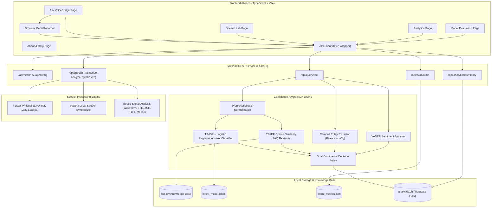
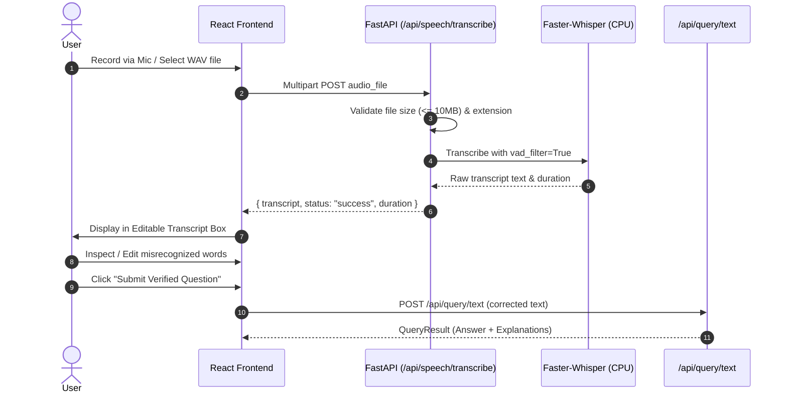
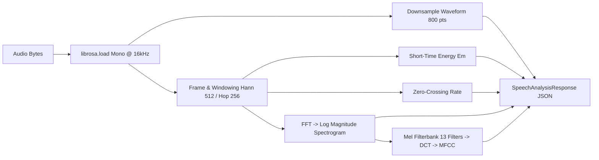

# VoiceBridge Architecture Specification

## 1. System Overview

**VoiceBridge** is a speech-enabled campus helpdesk that integrates intermediate Natural Language Processing (NLP) and Speech Signal Processing into a decoupled client-server architecture:

- **Frontend:** Single-page application built with React, TypeScript, and Vite.
- **Backend:** REST API built with FastAPI in Python 3.11, executed in an isolated virtual environment (`.venv`).
- **Core Intelligence:** Offline, local NLP pipeline using scikit-learn, VADER sentiment, rule-based campus entity matching, local Faster-Whisper ASR, and librosa signal analysis.

---

## 2. Component Architecture Diagram

---

## 3. Data & Request Workflows

### 3.1 Text Query Processing Flow

1. **Input Submission:** User submits query text (length $\le 1000$ characters) via `POST /api/query/text`.
2. **Text Normalization:**
   - Leading/trailing whitespace trimmed;
   - English contractions expanded (e.g., *don't* $\to$ *do not*, *can't* $\to$ *cannot*);
   - Negation terms (*not*, *never*, *no*, *without*) strictly preserved;
   - Text converted to lowercase for vocabulary matching.
3. **Intent Classification:**
   - Normalized text is transformed via a trained `TfidfVectorizer` (unigrams + bigrams, sublinear TF);
   - Evaluated by a `LogisticRegression` model with balanced class weights;
   - Returns top class and uncalibrated classifier score ($p_{\max}$).
4. **FAQ Retrieval:**
   - FAQ corpus (`question` + `keywords` + `office_or_category`) is indexed with TF-IDF;
   - Cosine similarity $\operatorname{sim}(Q, F_i) = \frac{Q \cdot F_i}{\|Q\| \|F_i\|}$ is computed against all candidates;
   - Top matching candidate and relevance score $S_{\text{faq}} \in [0, 1]$ are returned.
5. **Entity & Sentiment Extraction:**
   - Regex patterns identify campus entities (departments, semesters, campus services, administrative offices, exam types, dates);
   - VADER produces compound polarity scores mapped to *positive*, *neutral*, or *negative*.
6. **Dual-Confidence Decision Policy:**
   - If $S_{\text{faq}} < \theta_{\text{faq}}$ ($0.30$): Output `no_answer` with safe fallback suggestions;
   - If $p_{\max} < \theta_{\text{intent}}$ ($0.15$): Output `clarification_needed` with suggested categories;
   - If $\text{Intent}_{\text{pred}} \neq \text{Intent}_{\text{faq}}$ and $S_{\text{faq}} < 0.55$: Output `clarification_needed`;
   - If both thresholds are met: Output `answered` with matched verified FAQ content.
7. **Metadata Audit Logging:**
   - Timestamp, input mode, predicted intent, confidence score, FAQ similarity, and outcome status are logged into SQLite;
   - Raw query text and audio recordings are **never** stored by default.

---

### 3.2 Spoken Query Flow (Speech-to-Text & Transcript Verification)

---

### 3.3 Speech Lab Signal Analysis Pipeline

---

## 4. Privacy & Security Architecture

1. **Ephemeral Audio Storage:** Audio files uploaded for ASR or Speech Lab feature analysis are read directly from memory buffers or transient files cleaned up in `try...finally` blocks.
2. **Metadata-Only Analytics:** SQLite `query_events` table contains no personally identifiable student information (no student names, IDs, IP addresses, or raw query strings).
3. **Restricted CORS Policy:** Strict origin allowlist (`http://localhost:5173`, `http://127.0.0.1:5173`) prevents arbitrary third-party cross-origin requests.
4. **Input Sanitization & Length Limits:** Maximum query text length bounded to 1,000 characters; audio uploads bounded to 10 MB.
